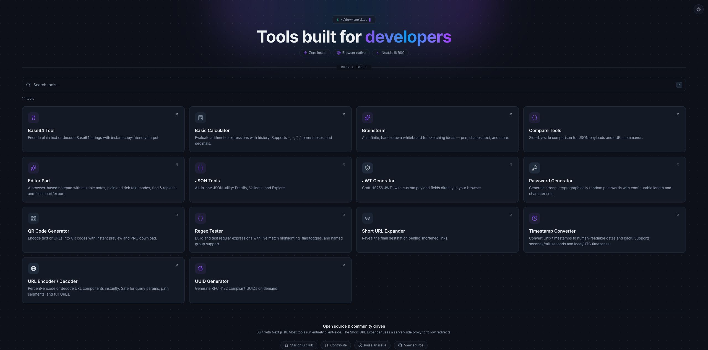

# Dev Toolkit

[](LICENSE)

Everyday developer utilities in one searchable browser workspace: format JSON, compare payloads, test regex, generate QR codes, keep notes, and sketch on a whiteboard.

**[Try the hosted toolkit](https://mopplications.com/)** · [Run locally](#run-locally) · [Questions and feedback](https://github.com/chandanankush/dev-tools/discussions)

Made by **[Chandan Singh](https://www.linkedin.com/in/chandan-singh-mobileengineer/)** · [GitHub](https://github.com/chandanankush)



*Actual interface from an isolated local production-mode server. The [short URL-encoding walkthrough](docs/assets/toolkit-demo.gif) uses invented example text and two captured states, with condensed timing.*

## Useful starting points

| Need | Tool | Example |
| --- | --- | --- |
| Read a response | JSON Tools | Format `{"name":"demo","ready":true}` and explore its tree |
| Compare requests | Compare Tools | Compare two sanitized JSON payloads or cURL commands |
| Escape a query value | URL Encoder / Decoder | Encode `hello world` to `hello%20world` |
| Share text visually | QR Code Generator | Encode `https://example.com` and download a PNG |
| Work through an idea | Editor Pad / Brainstorm | Write a note or draw on the whiteboard |

Also available: Base64, calculator (including Weight Price), JWT generation, passwords, regex, short URL expansion, timestamps, and UUIDs. See the [full tool reference](docs/user-tools.md).

## Run locally

Requirements: Node.js 26 and pnpm 10+, following the [contribution guide](docs/CONTRIBUTING.md).

```sh
git clone https://github.com/chandanankush/dev-tools.git
cd dev-tools
pnpm install --frozen-lockfile
pnpm dev
```

Open <http://localhost:3000>. For a production build, run `pnpm build` and then `pnpm start`. For self-hosting with Docker, see [deployment](docs/DEPLOYMENT.md).

## Data handling and limitations

- Most utility processing takes place in your browser. **Short URL Expander sends the submitted URL to the server**, which makes network requests to resolve redirects. Read the [privacy policy](https://mopplications.com/privacy) before using sensitive data.
- Saved notes, calculator history, theme, and drawing preferences use browser storage. Storage limits apply; clearing site data can remove saved work. Export notes you need to keep.
- No universal offline guarantee: initial page loading, external resources, and the URL expander may need network access. Clipboard and download behavior depend on browser permissions and capabilities.
- Password/JWT utilities are tools, not a credential vault or token-security audit. Use invented values in public examples and reports.
- This repository's source and the hosted deployment may differ. A release or passing test run does not establish compatibility with every device.

## Support and contribution

Ask questions in [Discussions](https://github.com/chandanankush/dev-tools/discussions), starting with the [welcome thread](https://github.com/chandanankush/dev-tools/discussions/98). [Report reproducible bugs](https://github.com/chandanankush/dev-tools/issues/new/choose) with the tool URL, browser/OS, and sanitized input.

Read [CONTRIBUTING](docs/CONTRIBUTING.md) and browse [good first issues](https://github.com/chandanankush/dev-tools/labels/good%20first%20issue) or [browser-testing requests](https://github.com/chandanankush/dev-tools/labels/help%20wanted). Runtime contributions follow the repository's `development` → `main` PR workflow.

Developer references: [architecture](docs/ARCHITECTURE.md), [scripts and implementation](docs/project-reference.md), [test cases](testcase.md), and [agent rules](AGENTS.md).

## License

[MIT](LICENSE).
