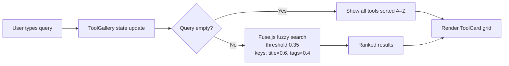
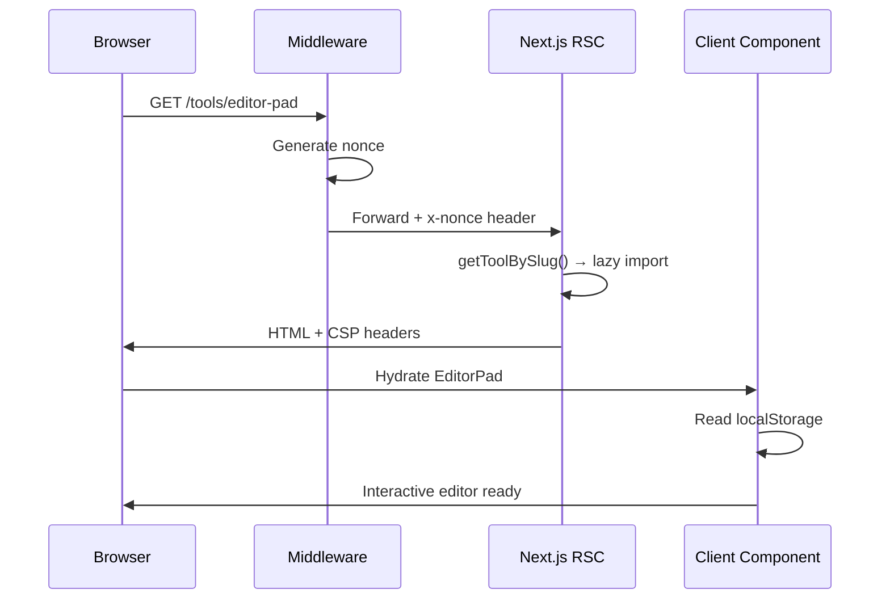
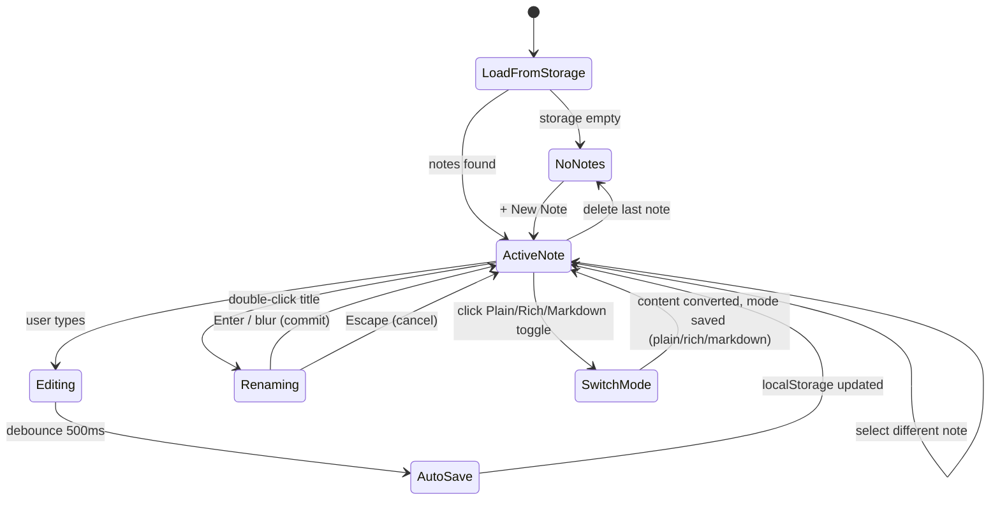
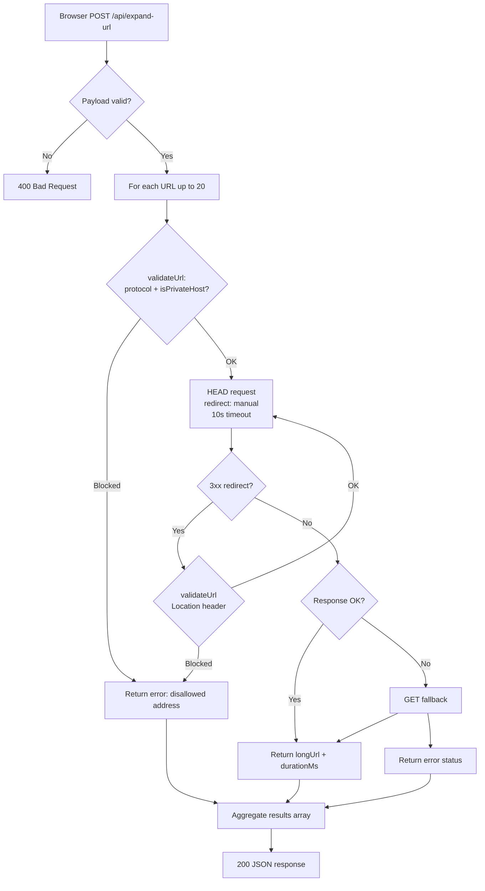

# Architecture

Live at **https://mopplications.com**

---

## Overview

Dev Toolkit is a **browser-first** developer utility suite. The architecture follows a single guiding constraint: **all tool logic runs on the client; the server exists only to serve the Next.js app and proxy redirect-following for the URL Expander.**

```
Browser                             Server (Node 26)
──────────────────────────          ──────────────────────────────
All tool state (localStorage)  ←→  Next.js App Router (standalone)
All tool computation                /api/expand-url  ← server-side URL redirect follower
                                    /api/visits      ← footer visitor count (one integer on disk)
Dark/light theme persistence        Middleware: CSP nonce, security headers
```

---

## Stack

| Layer | Technology | Notes |
|---|---|---|
| Framework | Next.js 16 (App Router) | `output: "standalone"` for Docker |
| Language | TypeScript (strict) | |
| Styling | Tailwind CSS v4 | CSS-first config via `@theme inline`, dark mode via `@custom-variant dark` |
| UI primitives | shadcn/ui (Radix) | Button, Input, Label, Textarea |
| Icons | lucide-react 1.x | Brand icons (Github, Linkedin) replaced with inline SVGs |
| Rich text | Tiptap v3 (ProseMirror) | CSP-safe, no eval |
| PDF export | react-to-pdf 3.x (html2canvas) | Client-side only; adaptive canvas scale, light-mode forcing for dark-theme correctness |
| Search | Fuse.js v7 | Fuzzy search across tool titles and tags |
| Whiteboard rendering | roughjs 4.x | Hand-drawn canvas rendering for Brainstorm |
| Markdown | react-markdown + remark-gfm | Markdown preview mode in Editor Pad |
| State | React 19 `useState` / `useReducer` | No global state manager |
| Persistence | `localStorage` only | No database, no sessions |
| Package manager | pnpm | Strict lockfile (`--frozen-lockfile` in CI) |
| Testing | Vitest 4 + @testing-library/react | jsdom environment, Vite 8 peer dep required |

---

## Directory structure

```
/
├── app/
│   ├── layout.tsx              Global HTML shell — ThemeProvider, anti-FOUC nonce script
│   ├── page.tsx                Homepage — hero, ToolGallery (sorted A–Z), footer
│   ├── not-found.tsx           Custom 404
│   ├── privacy/
│   │   └── page.tsx            Privacy Policy page (/privacy)
│   ├── robots.ts               Auto-generated robots.txt
│   ├── sitemap.ts              Auto-generated sitemap.xml (all tool slugs)
│   └── api/
│       ├── expand-url/
│       │   └── route.ts        POST — server-side URL redirect follower
│       └── visits/
│           └── route.ts        GET/POST — visitor count (same-origin + rate-limited POST)
│   └── tools/
│       └── [slug]/
│           └── page.tsx        Dynamic route — renders any registered tool
│
├── components/
│   ├── ThemeProvider.tsx        React context + localStorage for dark/light mode
│   ├── ThemeToggle.tsx          Fixed top-right Sun/Moon button
│   ├── ToolCard.tsx             Card tile shown on homepage grid
│   ├── ToolGallery.tsx          Client component — Fuse.js search + tag filtering
│   ├── ToolShell.tsx            Wrapper for individual tool pages (back link, title, card)
│   ├── tools/                   One file per tool (lazy-loaded, "use client")
│   │   ├── Base64Utility.tsx
│   │   ├── BasicCalculator.tsx      # Calculator tab + Weight Price tab
│   │   ├── CompareTools.tsx
│   │   ├── EditorPad.tsx
│   │   ├── JsonTools.tsx
│   │   ├── JsonViewer.tsx       Sub-component used by JsonTools
│   │   ├── JwtGenerator.tsx
│   │   ├── PasswordGenerator.tsx
│   │   ├── QrCodeGenerator.tsx
│   │   ├── RegexTester.tsx
│   │   ├── TimestampConverter.tsx
│   │   ├── UrlEncoderDecoder.tsx
│   │   ├── UrlExpander.tsx
│   │   ├── UuidGenerator.tsx
│   │   ├── WeightPriceCalculator.tsx  # Embedded as tab in BasicCalculator
│   │   └── Brainstorm.tsx      # Hand-drawn whiteboard (fullBleed tool), roughjs rendering, two-finger touch nav
│   └── ui/                      shadcn/ui primitives
│       ├── button.tsx
│       ├── input.tsx
│       ├── label.tsx
│       └── textarea.tsx
│
├── lib/
│   ├── tools.config.ts          Single source of truth for all tools
│   ├── search.ts                Fuse.js wrapper with memoised index
│   ├── base64.ts                Pure encode/decode utilities
│   ├── jwt.ts                   HS256 JWT sign/verify (browser SubtleCrypto)
│   └── utils.ts                 Tailwind cn() helper
│
├── styles/
│   └── globals.css              Tailwind v4 CSS-first config (@theme inline, @custom-variant dark) + HSL tokens + Tiptap styles
│
├── tests/
│   ├── setup.ts                 Vitest global setup (next/image mock, cleanup)
│   ├── tools/                   Per-tool regression tests (15 files)
│   ├── brainstorm/              Brainstorm engine unit tests (geometry, scene, history, viewport, serialize, storage, render, gesture — 8 files)
│   └── seo/                     Sitemap and metadata tests (2 files)
│
├── proxy.ts                 Next.js 16 middleware — CSP nonce generation + security response headers
├── next.config.ts                standalone output, poweredByHeader: false, esmExternals
├── Dockerfile                    Multi-stage build (deps → builder → runner, non-root USER, port 3050)
├── Jenkinsfile                   CI/CD pipeline (precheck → build → SSH deploy to Raspberry Pi → verify, no registry)
└── ci/                           Scripts the pipeline pipes to the deploy host (remote-precheck.sh, verify-deploy.sh)
```

---

## Tool registry

All tools are registered once in `lib/tools.config.ts`. Adding a tool requires zero changes to routing, sitemap, or search. Optional `fullBleed: true` (used by `brainstorm`) drops the tool page's vertical padding and lets ToolShell fill `100dvh` with a compact header — for canvas-style tools that need maximum drawing space.

| Slug | Component | Server-side? |
|---|---|---|
| `base64-tool` | Base64Utility | No |
| `basic-calculator` | BasicCalculator | No |
| `brainstorm` | Brainstorm — infinite hand-drawn whiteboard (roughjs), full-bleed layout | No |
| `compare-tools` | CompareTools — JSON: side-by-side visual diff with red/green row highlighting; cURL: structured field table | No |
| `editor-pad` | EditorPad | No |
| `json-tools` | JsonTools | No |
| `jwt-generator` | JwtGenerator | No |
| `password-generator` | PasswordGenerator | No |
| `qr-code-generator` | QrCodeGenerator | No |
| `regex-tester` | RegexTester | No |
| `short-url-expander` | UrlExpander | **Yes** — proxies via `/api/expand-url` |
| `timestamp-converter` | TimestampConverter | No |
| `url-encoder-decoder` | UrlEncoderDecoder | No |
| `uuid-generator` | UuidGenerator | No |

---

## Request lifecycle

### Homepage

```
Browser → GET /
  → Next.js RSC renders page.tsx
    → toolSummaries (static, sorted A–Z) passed to ToolGallery
      → ToolGallery hydrates client-side
        → Fuse.js index built in memory
        → User types → fuzzy search → re-render cards
```

### Tool page

```
Browser → GET /tools/editor-pad
  → proxy.ts runs first
    → generates nonce
    → attaches CSP + security headers
  → Next.js renders [slug]/page.tsx (RSC)
    → getToolBySlug("editor-pad") → lazy import EditorPad
    → EditorPad hydrates client-side
      → reads localStorage ("editorpad-notes", "editorpad-active")
      → Tiptap editor initialised with immediatelyRender: false (SSR-safe)
```

### Compare Tools (client-side diff engine)

```
Browser → GET /tools/compare-tools
  → Next.js renders [slug]/page.tsx (RSC)
    → lazy import CompareTools
    → CompareTools hydrates client-side

JSON Compare flow:
  User pastes JSON A + JSON B → clicks Compare
    → JSON.parse() both inputs (throws on invalid JSON)
    → buildSideBySideRows() recurses over both object trees
        identical subtrees → "none" highlight (context rows, both sides)
        primitive/type mismatch → renderLines() for each side →
            left cells "removed" (red), right cells "added" (green)
        object key only in A → left "removed", right cell empty
        object key only in B → left cell empty, right "added" (green)
    → countJsonDiff() for the difference badge count
    → React renders two-column grid (JSON A | JSON B) with coloured rows

cURL Compare flow:
  User pastes cURL A + cURL B → clicks Compare
    → tokenize() → parseCurl() extracts method, url, headers, body
    → diffCurl() produces [{ field, leftValue, rightValue }]
    → React renders table: Field | cURL A (red) | cURL B (green)
```

### URL Expander (only server-side tool)

```
Browser → POST /api/expand-url  { urls: ["https://bit.ly/xyz"] }
  → proxy.ts (CSP headers)
  → route.ts (server)
    → HEAD request to short URL with timeout (10s)
    → falls back to GET if HEAD fails
    → returns { shortUrl, longUrl, status, durationMs }
  → Browser displays expanded URL
```

---

## Security model

All handled in `proxy.ts` (Next.js 16 middleware filename) which runs on **every non-static request**.

| Header | Value | Purpose |
|---|---|---|
| `Content-Security-Policy` | nonce-based, strict-dynamic | Prevents XSS |
| `Strict-Transport-Security` | max-age=31536000; includeSubDomains; preload | Forces HTTPS |
| `X-Frame-Options` | DENY | Prevents clickjacking |
| `X-Content-Type-Options` | nosniff | Prevents MIME sniffing |
| `Referrer-Policy` | strict-origin-when-cross-origin | Limits referrer leakage |
| `Permissions-Policy` | camera=(), microphone=(), geolocation=() | Disables sensitive APIs |
| `Cross-Origin-Opener-Policy` | same-origin | Prevents cross-origin window access |
| `Cross-Origin-Embedder-Policy` | require-corp | Enables cross-origin isolation |
| `Cross-Origin-Resource-Policy` | same-origin | Blocks cross-origin resource reads |

**Production CSP (strict):**
```
default-src 'self'
script-src 'nonce-<random>' 'strict-dynamic'
style-src 'self' 'nonce-<random>'
img-src 'self' data:
font-src 'self'
connect-src 'self'
frame-src 'none'
object-src 'none'
base-uri 'self'
form-action 'self'
upgrade-insecure-requests
```

**Dev CSP (relaxed for HMR):**
```
default-src 'self'
script-src 'self' 'nonce-<random>' 'strict-dynamic' 'unsafe-eval'
style-src 'self' 'nonce-<random>'
img-src 'self' data:
font-src 'self'
connect-src 'self' ws: wss:
frame-src 'none'
object-src 'none'
base-uri 'self'
form-action 'self'
```

`img-src 'self' data:` allows base64 data URIs used by the QR Code Generator preview without permitting arbitrary external images.

### Visitor counter — `/api/visits`

The footer shows "Visitors: N", counting **unique browsers**, and is the only server-side persistence in the app.

```
Browser (first visit) → localStorage flag "dt-visit-counted" absent
  → set flag, POST /api/visits  → { count }      (increment)
Browser (return visit) → flag present
  → GET /api/visits             → { count }      (read only)
```

- **Storage:** `lib/visit-counter.ts` keeps one integer in `<VISITS_DATA_DIR>/visits.json` (`/app/data` in Docker). Reads come from memory; increments are serialised and written atomically (temp file + rename). A damaged file is kept as `visits.json.corrupt` and counting restarts from 0. Single-process only — more than one instance would need a real database.
- **Deployment:** `/app/data` must be a mounted volume (`-v dev-tools-data:/app/data`, the Jenkins `REMOTE_RUN_ARGS` default) or the count resets whenever the container is replaced.
- **Abuse guard (basic, not authentication):** POST must be same-origin (`Sec-Fetch-Site` / `Origin`), limited to 5 per IP per minute, and capped at 100 per minute overall (`lib/visit-rate-limit.ts`). These limits bound how fast the count rises, not how high it goes — the stored total has no upper limit. The client IP is `cf-connecting-ip`, else the rightmost `X-Forwarded-For` hop (the leftmost is client-supplied). Headers can be forged by anyone who reaches the origin directly, so the overall cap is the real backstop: the count can never rise faster than 100 a minute. A flood can use up that budget and delay counting real visitors until the window passes — an accepted trade-off for a visitor count. Keep the origin behind Cloudflare / the reverse proxy rather than exposing the port. IPs live in memory for the window and are never written.
- **No ceiling on the total:** it is a plain JSON integer that only ever increases; nothing caps it.
- **Privacy:** no IP, user agent or per-visit record is stored; disclosed on `/privacy`. If localStorage is blocked the client only reads, so the count is never inflated.
- **No outbound requests**, so no SSRF surface. The CSP is unchanged (`connect-src 'self'`).

### API security — `/api/expand-url`

The URL Expander API prevents SSRF via three layers:
1. **Protocol allowlist** — only `http:` and `https:` are accepted.
2. **Private host blocklist** (`isPrivateHost`) — rejects RFC-1918, loopback (`127/8`, `::1`, `localhost`), link-local/metadata (`169.254/16`), and shared address space (`100.64/10`).
3. **Per-hop redirect validation** — uses `redirect: "manual"` and validates every `Location` header through `isPrivateHost` before following, preventing SSRF via open redirects on public hosts.

### Password Generator

Uses `unbiasedRandom(n)` (rejection sampling) instead of `crypto.getRandomValues()[0] % n` to eliminate modulo bias when `2^32` is not divisible by the charset size.

---

## Data flow diagrams

### Homepage search



### Tool page rendering



### EditorPad state machine



### URL Expander server flow



---

## Key architectural decisions

| Decision | Rationale |
|---|---|
| All tools run in the browser | Zero server costs for compute; no data leaves user's machine |
| Single `tools.config.ts` registry | One place to add/remove tools; routing, sitemap, search all auto-update |
| Tiptap v3 for rich text | ProseMirror-based, CSP-safe (no eval), MIT licence, table support |
| Tailwind CSS v4 (CSS-first) | `@theme inline` replaces `tailwind.config.ts`; `@custom-variant dark` handles class-based dark mode; `tw-animate-css` replaces `tailwindcss-animate` |
| `output: standalone` | Minimal Docker image — only ships the Node server + `.next/standalone` |
| Nonce-based CSP over hash-based | Per-request nonces are immune to static analysis attacks; compatible with `'strict-dynamic'` |
| localStorage only (plus the visitor count file) | No auth, no sessions or database, minimal GDPR surface; tools work offline. The one server-side file is an aggregate visitor count |
| Fuse.js threshold 0.35 | Balanced between precision (avoid false positives) and recall (typo tolerance) |
